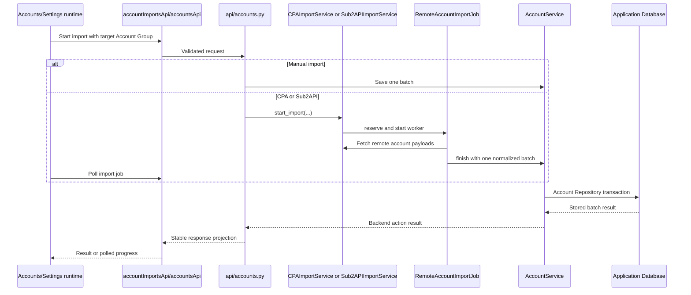
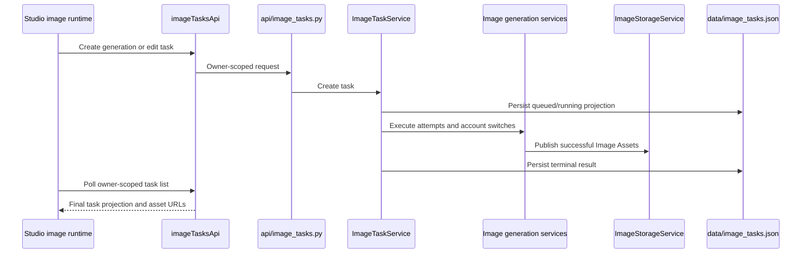
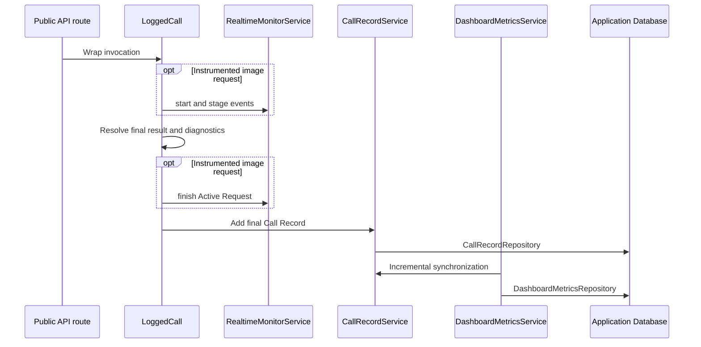
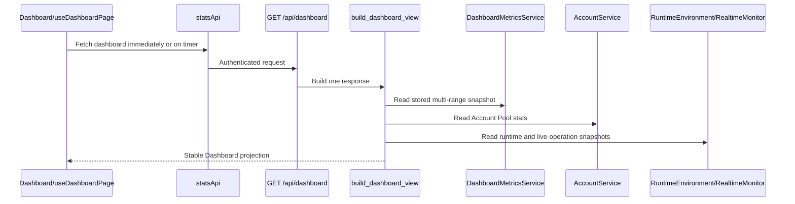
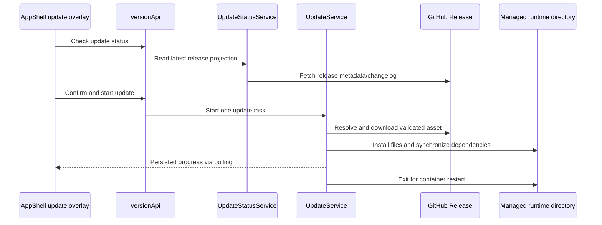

# Critical Flows

Status: current

These sequences identify the lifecycle owner and handoff points for workflows
that cross multiple Modules. They are navigation maps, not substitutes for
contracts or implementation.

## Account import

Manual JSON/credential import writes through the account API and
`AccountService`. CPA and Sub2API use one shared remote-job lifecycle.

`RemoteImportJobCoordinator` enforces the shared active-job rule. Both remote
sources finish through `RemoteAccountImportJob.finish`; source adapters do not
implement a second save lifecycle. The UI owns polling and presentation only.

## Upstream Account memory maintenance

The Accounts runtime sends an explicit or scoped selection and an enable,
disable, refresh or clear action to `POST /api/accounts/memory`. The route resolves
a fixed list of management IDs and schedules `AccountService.manage_account_memory` through
the existing background operation lifecycle. The service obtains credentials
and account-processing capacity, calls `OpenAIBackendAPI`, and persists only
the relevant account metadata under credential and operation compare-and-swap
guards. In-process mutual exclusion covers switch and clear operations on the
same account; it does not provide cross-process upstream serialization.
A PATCH is followed by a settings read; accepted updates without verification
remain pending, while confirmed values update the switch snapshot.

Clearing sends `DELETE /backend-api/settings/clear_account_user_memory` with
JSON `{}` and reads `GET /backend-api/memories?include_memory_entries=true`
with cache bypass. Only an explicit empty `memories` list and
`memory_num_tokens=0` confirm success. Other accepted outcomes remain pending.
The clear record is independent of the switch snapshot and does not store
memory contents. Refreshing a pending clear performs verification only, never
another DELETE; confirmation updates the last-success time while retaining the
original attempt time. Failed verification preserves the switch snapshot and
past clear-success time. A historical clear does not imply that no memories
were saved afterward.

The clearing protocol is supported by `clearUserMemory`, `deleteWithPayload`
and `getMemories` in the
[third-party archive of the ChatGPT frontend source](https://github.com/0xdevalias/chatgpt-source-watch/blob/88970f48f28e18a41341e446374f9727187dff08/unpacked/_next/static/chunks/pages/_app.js#L80875)
from April 26, 2024. The archive's content commit explicitly identifies that
date. This is historical protocol evidence, not official public API documentation.
The archive establishes the base `/memories` route. Current single-account
verification of both switch values, the clearing request and the
`include_memory_entries=true` read-back is recorded in the
[requirement verification evidence](../requirements/0002-account-memory-controls.md#acceptance-criteria-and-verification-matrix).

The switch snapshot feeds the shared account filter; clear history is shown
only in memory details.
Vue polls the generic operation endpoint
and renders backend-produced events and counters. Process restart loses the
existing in-memory progress and does not replay upstream changes.

## Studio Image Task

`ImageTaskService` owns task admission, transitions, attempts, resumption, and
terminal state. `ImageStorageService` exclusively owns Image Asset catalogue and
storage mutations. Studio owns browser conversation presentation and polling,
not task truth.

## Call Record, live monitor, and metrics

The Call Record is durable final truth. Active Requests and live operations are
process-memory observations and may disappear on restart. The Dashboard Metric
Projection reads only Call Records after its stored sequence during normal
synchronization, updates affected hourly rows atomically, and rebuilds only when
an explicit repository operation rotates the Call Record generation or an
aggregate table is structurally incompatible. User-facing log deletion and
automatic retention preserve the cursor, so the 30-day history remains
independent of the shorter Call Record retention window. If only the projection
state table is recreated, startup checkpoints the current cursor without
deleting compatible hourly aggregates.

## Dashboard projection

The backend owns metric definitions, available ranges, units, health, and
runtime values. Account cards and Active Request counts read current state;
24-hour call cards and all chart ranges come from the same 30-day hourly
projection; runtime-environment samples are not persisted. The page selects one
returned range and owns refresh timing, retained snapshots, chart construction,
animation, layout, and responsive behavior.

## Managed-container online update

`UpdateService` owns the complete update task and rejects unsupported runtime
modes. The frontend only confirms, starts, polls, and renders progress. Update
task state is persisted in `data/update_task.json`; the container runtime owns
restarting the process after exit.
